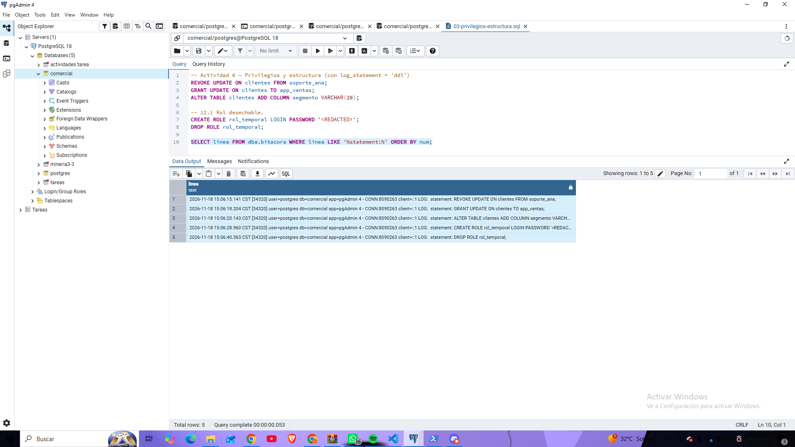

# Evidencia 06 — Privilegios y estructura

**Estudiante:** Luis Alejandro Navarrete Diaz
**Actividad:** 6

## Comando ejecutado

Ver `sql/03-privilegios-estructura.sql`:

```sql
REVOKE UPDATE ON clientes FROM soporte_ana;
GRANT UPDATE ON clientes TO app_ventas;
ALTER TABLE clientes ADD COLUMN segmento VARCHAR(20);
CREATE ROLE rol_temporal LOGIN PASSWORD '<REDACTED>';
DROP ROLE rol_temporal;
SELECT linea FROM dba.bitacora WHERE linea LIKE '%statement:%' ORDER BY num;
```

## Resultado obtenido



## Interpretación

La bitácora muestra quién (user=postgres), cuándo, desde dónde (client=[local]) y qué sentencia se ejecutó en cada cambio. La contraseña de `rol_temporal` quedó en texto claro en la bitácora y eliminar el rol no la borra. `\password` calcula el resumen SCRAM en el cliente y envía al servidor solo ese resumen.

**1. ¿Qué tipo de evento es cada una de las tres primeras sentencias?**
- `REVOKE UPDATE ON clientes FROM soporte_ana`: privilegio.
- `GRANT UPDATE ON clientes TO app_ventas`: privilegio.
- `ALTER TABLE clientes ADD COLUMN segmento ...`: estructura.

**2. ¿Por qué GRANT y REVOKE quedan registrados con `log_statement = 'ddl'`?**
Porque el nivel `ddl` registra las sentencias de definición de datos (CREATE, ALTER, DROP) y también GRANT, REVOKE y COMMENT.

**3. Si la bitácora contiene contraseñas, ¿quién debería poder leerla? Relación con la gestión de secretos de la Unidad II.**
Solo el administrador o el custodio designado de la evidencia. Si la bitácora contiene secretos, hay que tratarla como un secreto más: acceso restringido, no subirla a repositorios sin revisarla y retirar las contraseñas antes de exportarla. Por eso en la Unidad II las contraseñas no se escriben en sentencias, sino que se usan `\password`, un gestor de secretos o `.pgpass`.